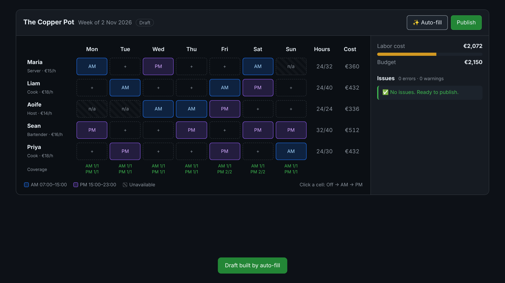

# SimpleShiftCraft

A small restaurant shift scheduler. It helps a manager build a weekly labor plan that balances **profitability**, **staff predictability** and **guest coverage**, and it explains every problem in plain English.



**Design docs:** architecture, data model, UX, flowcharts and an interactive mockup are in [`docs/design.html`](docs/design.html).

## Run it

**Option A: Docker (Postgres included)**

```bash
docker compose up
```

**Option B: Node only (in-memory data, no database needed)**

```bash
npm install
npm run dev
```

Open <http://localhost:5173>. The demo week starts with three deliberate problems. Click **Auto-fill** to fix them, then **Publish**.

| | URL |
|---|---|
| Web app | http://localhost:5173 |
| REST API | http://localhost:4000/api/schedules/00000000-0000-4000-8000-000000000042 |
| GraphQL (GraphiQL in the browser) | http://localhost:4000/graphql |

## What it does

- **Week grid:** click a cell to cycle Off → AM → PM.
- **Five rules, checked live:** availability, clopening (less than 10h rest), max weekly hours, coverage per slot, and labor budget.
- **Errors vs warnings:** errors harm staff and block publishing. Warnings (under-staffed slots, over budget) are the manager's call.
- **Auto-fill:** a greedy, explainable pass that gives each slot to the eligible person with the fewest hours.

## How it's built

```
web (React + Vite) ──GraphQL reads──▶ api (Node + TypeScript) ──▶ ShiftRepository ──▶ PostgreSQL
                    ──REST writes───▶   rest.ts / graphql.ts                         (in-memory for tests)
                                          └─ service.ts → domain/scheduler.ts (pure rules)
```

| Path | What's in it |
|---|---|
| `api/src/domain/scheduler.ts` | All scheduling rules as pure functions, the core of the app |
| `api/src/service.ts` | Use cases (view, set assignment, auto-fill, publish), shared by REST and GraphQL |
| `api/src/rest.ts`, `graphql.ts` | Thin transport layers |
| `api/src/db/` | `ShiftRepository` interface, Postgres and in-memory implementations |
| `api/migrations/` | Plain SQL schema + seed data |
| `web/src/App.tsx` | The week grid screen |
| `docs/adr/` | Short records of the key decisions |

## API examples

```bash
# Read the whole week in one GraphQL query
curl -s localhost:4000/graphql -H 'content-type: application/json' \
  -d '{"query":"{ schedule(id:\"00000000-0000-4000-8000-000000000042\") { laborCostCents issues { severity message } } }"}'

# Set one cell (idempotent: safe to retry)
curl -s -X PUT localhost:4000/api/schedules/00000000-0000-4000-8000-000000000042/assignments \
  -H 'content-type: application/json' -d '{"employeeId":"<id>","day":0,"slot":"AM"}'

# Publish: returns 409 with the list of errors if any remain
curl -s -X POST localhost:4000/api/schedules/00000000-0000-4000-8000-000000000042/publish
```

## Quality

```bash
npm test          # 13 tests: scheduling rules + API smoke tests (Vitest + Supertest)
npm run lint      # ESLint (typescript-eslint)
npm run typecheck # strict TypeScript, both packages
```

CI runs all three on every push and pull request (`.github/workflows/ci.yml`).

## Key decisions

- [ADR 001: REST for writes, GraphQL for reads](docs/adr/001-rest-and-graphql.md)
- [ADR 002: Greedy auto-fill instead of a solver](docs/adr/002-greedy-auto-fill.md)
- Money is stored as integer cents and times as `timestamptz`, so the 10-hour rest rule survives daylight-saving changes.
- The database also enforces the rules that protect staff (`UNIQUE(employee_id, starts_at)`), so a bug in the API can't double-book anyone.

## Deliberately left out

Auth, multi-restaurant permissions, shift swaps, payroll and sales forecasting. They're out of scope for a sample, and listed in the [design docs](docs/design.html#overview).


